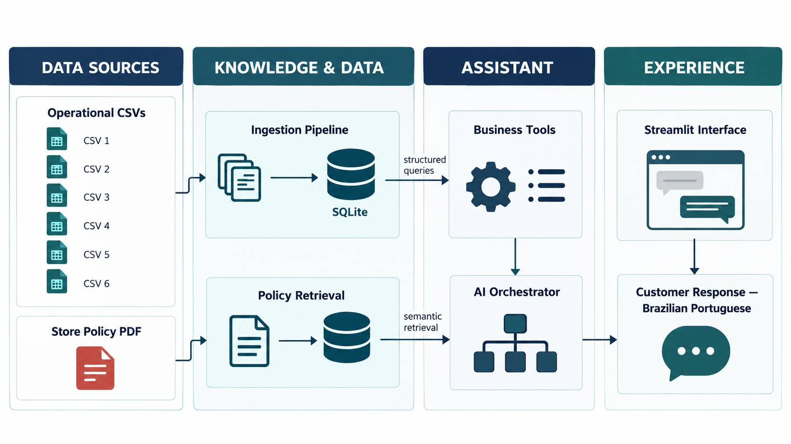
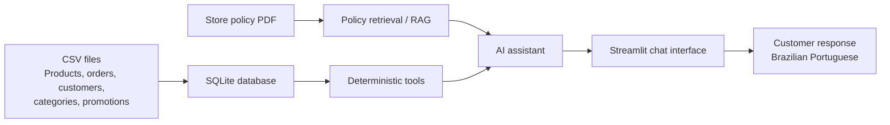

# Emporio Music AI Assistant

An English-source-code MVP for a Brazilian music store assistant. The customer-facing assistant responds in Brazilian Portuguese, while source code, prompts, configuration, tests, examples, and documentation remain in English.

## Architecture





```text
CSV files -> validated SQLite tables -> deterministic tools -> assistant
PDF policy -> text extraction -> lightweight policy retrieval -> assistant
Streamlit chat -> assistant -> Portuguese customer response
```

Operational data uses SQLite and SQL-backed tools for products, prices, stock, promotions, and orders. Store policies use a small local retrieval layer. OpenAI is optional: without `OPENAI_API_KEY`, the deterministic fallback remains usable for demos and tests.

## Quick start

```bash
python -m venv .venv
# Windows: .venv\\Scripts\\activate
pip install -r requirements.txt
python scripts/ingest_data.py
streamlit run streamlit_app.py
```

Copy `.env.example` to `.env` and provide `OPENAI_API_KEY` to enable the LLM response layer. The ingestion script can be rerun after CSV updates; it replaces each imported table atomically within the SQLite transaction.

## Example questions

- `Quais violões estão disponíveis por até R$ 1.000?`
- `Quanto custa o Yamaha C40?`
- `Posso devolver um produto que comprei?`
- `Qual é o desconto no PIX?`
- `Qual é o status do pedido 1?`
- `Qual é a previsão do tempo hoje?` (out-of-scope handling)

## MVP limitations

The local retriever is intentionally lightweight and does not require a vector database. A production deployment should add embeddings, authentication for order lookups, schema validation, audit logs, and a scheduled ingestion job with staging tables and reconciliation.
