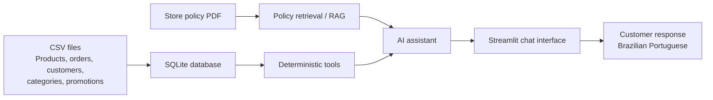
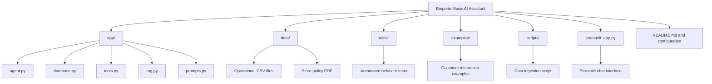

# Emporio Music AI Assistant

An English-source-code MVP for a Brazilian music store assistant. The customer-facing assistant responds in Brazilian Portuguese, while source code, prompts, configuration, tests, examples, and documentation remain in English.

## Architecture




```text
CSV files -> validated SQLite tables -> deterministic tools -> assistant
PDF policy -> text extraction -> lightweight policy retrieval -> assistant
Streamlit chat -> assistant -> Portuguese customer response
```

## Repository organization

The repository is separated by responsibility so that data ingestion, application logic, retrieval, testing, examples, and documentation can evolve independently.

```text
emporio-music-ai-assistant/
├── app/
│   ├── agent.py          # Assistant orchestration and response logic
│   ├── database.py       # SQLite schema, ingestion, and queries
│   ├── tools.py          # Deterministic business tools
│   ├── rag.py            # Store policy extraction and retrieval
│   └── prompts.py        # English system instructions
├── data/
│   ├── products.csv
│   ├── categories.csv
│   ├── promotions.csv
│   ├── customers.csv
│   ├── orders.csv
│   ├── order_items.csv
│   └── store_policies.pdf
├── examples/
│   └── sample_conversations.md
├── tests/
│   └── test_tools.py
├── scripts/
│   └── ingest_data.py
├── outputs/
│   └── emporio-music-ai-assistant-architecture.png
├── streamlit_app.py
├── requirements.txt
├── .env.example
├── .gitignore
└── README.md
```



Operational data uses SQLite and SQL-backed tools for products, prices, stock, promotions, and orders. Store policies use a small local retrieval layer. OpenAI is optional: without `OPENAI_API_KEY`, the deterministic fallback remains usable for demos and tests.

## Technical decisions

### Agent framework and approach

The MVP uses a hybrid assistant rather than a fully autonomous SQL agent. Deterministic Python tools handle operational questions such as product lookup, price, stock, promotions, PIX pricing, and order status. Policy questions use retrieval over the store policy PDF. An optional OpenAI response layer can provide natural-language orchestration when `OPENAI_API_KEY` is configured.

This approach was selected because prices, inventory, promotions, and order status require predictable database queries. Relying on a language model to generate unrestricted SQL would increase the risk of inaccurate or unauthorized answers. The design keeps business rules in testable Python code and leaves language generation to the model only when it adds value.

### Model and provider

The default optional model is `gpt-4o-mini` through the OpenAI API because it is fast and cost-effective for customer-support conversations. The provider is configurable through `OPENAI_MODEL`. The application also includes a deterministic fallback, so the core demonstration does not depend on an API key, network availability, or a paid model.

### Interaction interface

The project uses Streamlit because it provides a fast, visible chat interface for evaluating the agent without adding backend complexity. The same `EmporioAssistant` class can later be exposed through FastAPI, a messaging webhook, or a CLI without changing the data and policy layers.

### Conversation history and persistence

Conversation history is kept in Streamlit session state during the active browser session. Persistent conversation storage was intentionally left out of the MVP because the challenge focuses on correct customer responses and data grounding. A production version should add authenticated customer sessions, privacy controls, retention rules, and a database table for conversation events.

### Data treatment and consistency

The ingestion script reads the six CSV files using UTF-8 handling, recreates the corresponding SQLite tables, and preserves the source columns needed by the assistant. The application checks that operational tables contain rows and automatically ingests the bundled CSVs when the local database is missing or empty. SQLite foreign-key relationships are represented through shared identifiers, while deterministic queries join products, categories, customers, orders, and order items as needed.

For a production pipeline, the next step would be staged imports, schema validation, duplicate detection, row-level reconciliation, versioned source files, and transactional upserts instead of full table replacement.

### Why a hybrid design

Structured operational data and unstructured policy content have different accuracy requirements. SQL-backed tools are used for current business data, while policy retrieval is used for document content. This separation makes the system easier to test, explain, and migrate from local SQLite to a managed relational database later.

## Quick start

```bash
python -m venv .venv
# Windows: .venv\\Scripts\\activate
pip install -r requirements.txt
python scripts/ingest_data.py
streamlit run streamlit_app.py
```

Copy `.env.example` to `.env` and provide `OPENAI_API_KEY` to enable the LLM response layer. The ingestion script can be rerun after CSV updates; it replaces each imported table atomically within the SQLite transaction.

## Example questions

- `Quais violões estão disponíveis por até R$ 1.000?`
- `Quanto custa o Yamaha C40?`
- `Posso devolver um produto que comprei?`
- `Qual é o desconto no PIX?`
- `Qual é o status do pedido 1?`
- `Qual é a previsão do tempo hoje?` (out-of-scope handling)

## Use of coding assistants

This project was developed with Codex as a coding assistant. The workflow used the assistant to inspect the provided CSV and PDF materials, propose the hybrid architecture, generate and revise Python implementation files, create tests, troubleshoot runtime behavior in VS Code, and improve the README and architecture diagrams. All generated code was reviewed through local execution in VS Code, Streamlit acceptance checks, and automated pytest tests. The customer-facing behavior and business rules were verified against the supplied data and store policies rather than accepted without testing.

## MVP limitations

The local retriever is intentionally lightweight and does not require a vector database. A production deployment should add embeddings, authentication for order lookups, schema validation, audit logs, and a scheduled ingestion job with staging tables and reconciliation.
